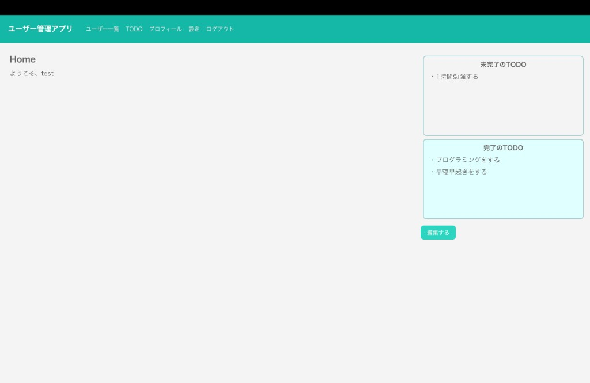
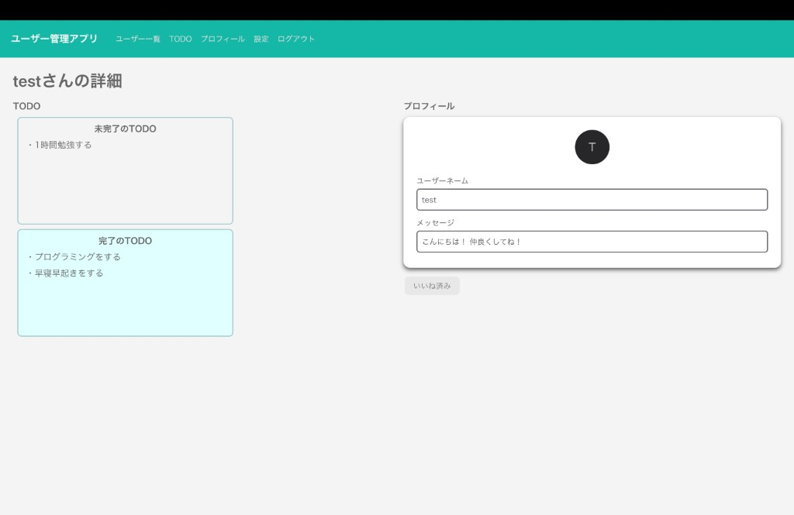
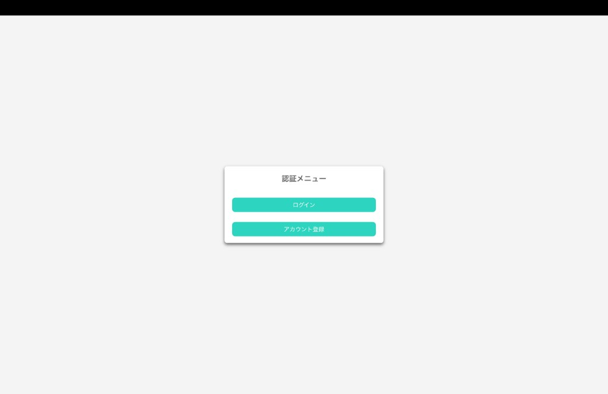

# Todo World

自分の TODO を作成・管理し、他ユーザーと共有できるフルスタック Web アプリケーションです。  
認証済みユーザーはプロフィールの編集、TODO の CRUD、ユーザー一覧からの他者プロフィール閲覧・いいねが行えます。

| | |
|---|---|
| **デモ** | https://todo-world-pqo8.vercel.app/ |
| **リポジトリ** | https://github.com/TKtkGg/todo-world |

---

## 概要

Todo World は、個人のタスク管理を起点に **「自分の TODO を世界に公開する」** 体験を実装したアプリです。

- ログインユーザーごとに TODO が DB 上で分離・永続化される
- ユーザー一覧から他者のプロフィールと TODO を閲覧できる
- 他者プロフィールへの「いいね」で、ソーシャルな相互作用を追加している

React × TypeScript のフロントエンドと Django REST Framework のバックエンドを初めて接続する学習プロジェクトとして着手し、**認証・データ永続化・権限分離** まで一通り設計・実装しました。

---

## スクリーンショット

### ホーム画面

ログイン後のダッシュボード。未完了・完了 TODO のプレビュー表示と、編集画面への導線を配置しています。



### 他ユーザーのプロフィール

ユーザー一覧から遷移する詳細画面。相手の TODO（閲覧専用）とプロフィール、いいねボタンを同一画面で表示します。



### 認証画面

未ログイン時のエントリーポイント。ログインとアカウント登録へ分岐します。



---

## 主な機能

| 機能 | 説明 |
|---|---|
| 認証 | ユーザー登録・ログイン・ログアウト（JWT） |
| TODO 管理 | 追加・完了・未完了への戻し・削除（ユーザー単位で DB 永続化） |
| プロフィール | ユーザーネーム・メッセージ・アイコン URL の取得・更新 |
| ユーザー一覧 | 登録ユーザーの一覧表示と詳細画面への遷移 |
| 他者 TODO 閲覧 | 他ユーザーの TODO を API 経由で取得・表示（編集不可） |
| いいね | 自分以外のユーザーに 1 回だけいいねを送れる |

---

## 技術スタック

| レイヤー | 技術 |
|---|---|
| Frontend | React 19, TypeScript, Vite, Chakra UI v3, React Router |
| Backend | Python, Django, Django REST Framework |
| 認証 | JWT（`djangorestframework-simplejwt`） |
| Database | SQLite |
| デプロイ | Vercel（フロントエンド） |

---

## 設計・実装のポイント

### 1. フロントとバックの責務分離

画面コンポーネントに `fetch` を散らさず、API 通信を `src/api/` に集約しています。  
Django 側の snake_case レスポンスはフロント側で camelCase に変換し、TypeScript の型と UI 層の命名を統一しています。

```
Component → src/api/*.ts → Django REST API → SQLite
```

### 2. JWT 認証とルートガード

- ログイン時に access / refresh トークンを発行
- `ProtectedRoute` が `/home` 配下の画面を保護し、未認証時はログイン画面へリダイレクト
- アクセストークン失効時は refresh トークンで再取得するフローを `src/api/auth.ts` に実装

### 3. TODO をサーバー正とした共有モデル

TODO は localStorage ではなく **バックエンド DB を正** として管理しています。

- 自分の TODO: `TodoContext` がログインユーザー ID の変化をトリガーに API から再取得
- 他者の TODO: `UserDetail` 画面で `GET /users/:id/todos` を呼び出し、相手の最新状態を表示

これにより、他ユーザーが TODO を更新した内容が、詳細画面を開いたタイミングで常にサーバー上のデータとして反映されます。

### 4. サーバー側での権限制御

TODO の更新・削除は `Todo.objects.get(pk=pk, user=request.user)` により **本人のリソースのみ** 操作可能にしています。  
いいねは `Like` モデルの `unique_together` 制約で、同一ユーザーへの重複送信を DB レベルで防止しています。

### 5. コンポーネント設計

Atomic Design を参考に、pages / organisms / molecules / atoms へ分割しています。  
`TodoListPreview` のように、Home（プレビュー）と UserDetail（他者閲覧）で共通 UI を再利用し、表示ロジックの重複を避けています。

### 6. 環境に応じた API 接続

`src/api/config.ts` で API ベース URL を環境変数 `VITE_API_BASE_URL` から読み込み、  
ローカル開発（`http://127.0.0.1:8000`）と本番デプロイを切り替えられる構成にしています。

---

## 開発で直面した課題と対応

| 課題 | 対応 |
|---|---|
| 初めてのフロント × バック連携 | REST API の入出力形式を Serializer / `src/api/` で明示的に定義し、通信層を 1 箇所に集約 |
| アカウント管理の設計 | Django の User モデルに Profile（1:1）、Todo（1:N）、Like（多対多相当）を関連付けてスキーマを整理 |
| 認証状態のフロント反映 | `AuthContext` でユーザー情報をアプリ全体に共有し、`ProtectedRoute` と `TodoContext` の連携でログイン状態に応じたデータ取得を実装 |
| フロントとバックの命名差 | API レスポンス変換層で snake_case → camelCase を統一 |

---

## ディレクトリ構成

```
todo-world/
├── backend/                      # Django REST API
│   ├── config/                   # settings.py, urls.py, WSGI
│   ├── accounts/                 # 認証・プロフィール・TODO・いいね
│   │   ├── models.py             # Profile, Todo, Like
│   │   ├── serializers.py        # リクエスト/レスポンス変換
│   │   ├── views.py              # API エンドポイント
│   │   └── urls.py
│   ├── requirements.txt
│   └── manage.py
├── docs/
│   └── screenshots/              # README 用スクリーンショット
├── src/                          # React フロントエンド
│   ├── api/                      # API 通信（auth, todo, profile, users, like）
│   ├── components/
│   │   ├── atoms/                # ボタン等の最小 UI
│   │   ├── molecules/            # MenuDrawer 等
│   │   ├── organisms/            # Header, ProfileCard, TodoList 等
│   │   ├── pages/                # 画面単位コンポーネント
│   │   ├── templates/            # HeaderLayout
│   │   ├── guard/                # ProtectedRoute
│   │   └── ui/                   # Chakra UI ラッパー
│   ├── contexts/                 # AuthContext, TodoContext
│   ├── hooks/                    # useAllUsers, useMessage
│   ├── router/                   # ルーティング定義
│   ├── styles/
│   └── theme/
├── vercel.json                   # SPA 用 rewrite 設定
└── package.json
```

---

## API 一覧（主要）

ベース URL: `{API_BASE_URL}/api/accounts`

| Method | Path | 説明 | 認証 |
|---|---|---|---|
| POST | `/register` | ユーザー登録 | 不要 |
| POST | `/login` | JWT 取得 | 不要 |
| POST | `/token/refresh` | トークン更新 | 不要 |
| GET | `/me` | ログイン中ユーザー情報 | 必要 |
| GET | `/users` | ユーザー一覧 | 必要 |
| GET | `/profile` | 自分のプロフィール取得 | 必要 |
| PUT | `/profile` | 自分のプロフィール更新 | 必要 |
| GET | `/users/:id/profile` | 他ユーザーのプロフィール | 必要 |
| GET | `/me/todos` | 自分の TODO 一覧 | 必要 |
| POST | `/me/todos` | TODO 作成 | 必要 |
| PATCH | `/me/todos/:id` | TODO 更新 | 必要 |
| DELETE | `/me/todos/:id` | TODO 削除 | 必要 |
| GET | `/users/:id/todos` | 他ユーザーの TODO 一覧 | 必要 |
| GET | `/users/:id/like` | いいね済みか確認 | 必要 |
| POST | `/users/:id/like` | いいね送信 | 必要 |

---

## 画面構成（ルーティング）

| パス | 画面 | 認証 |
|---|---|---|
| `/` | 認証トップ | 不要 |
| `/accounts/login` | ログイン | 不要 |
| `/accounts/register` | アカウント登録 | 不要 |
| `/home` | ホーム（TODO プレビュー） | 必要 |
| `/home/user_management` | ユーザー一覧 | 必要 |
| `/home/user_management/:userId` | ユーザー詳細 | 必要 |
| `/home/profile` | プロフィール編集 | 必要 |
| `/home/todo_list` | TODO 編集 | 必要 |

---

## セットアップ

フロントエンドとバックエンドは **別プロセス** で起動します。

### バックエンド

```bash
cd backend
python -m venv .venv
source .venv/bin/activate   # Windows: .venv\Scripts\activate
pip install -r requirements.txt
python manage.py migrate
python manage.py runserver
```

API は `http://127.0.0.1:8000` で起動します。

### フロントエンド

```bash
npm install
npm run dev
```

ブラウザで `http://localhost:5173` を開きます。

### 環境変数（任意）

| 変数名 | 用途 | デフォルト |
|---|---|---|
| `VITE_API_BASE_URL` | フロントから呼び出す API のベース URL | `http://127.0.0.1:8000` |

---

## 今後の改善予定

- [ ] スマートフォン向けレスポンシブデザインの強化
- [ ] ユーザー一覧への TODO プレビュー・ページネーション追加
- [ ] いいね数の集計表示
- [ ] JWT の保存方式見直し（HttpOnly Cookie 等、本番運用を想定した設計）

---

## ライセンス

このプロジェクトはポートフォリオ用途の個人開発作品です。
